HW2: Geoms in ggplot2
================
Aime Fidele Iradukunda (20252MBI010)
2026-10-31

A ggplot chart has three parts: the **data**, `aes()` to pick the
columns, and a **geom** to pick the shape. Below I use the main geoms on
R’s built-in data.

``` r
library(ggplot2)
library(dplyr)
```

## 1. One number variable: histogram and density

``` r
ggplot(mtcars, aes(x = mpg)) + geom_histogram(bins = 10)
```

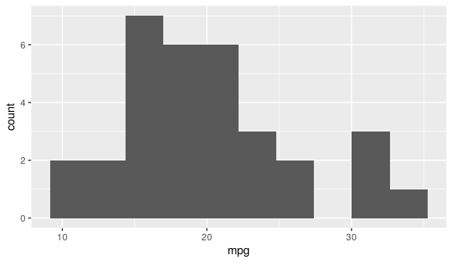<!-- -->

``` r
ggplot(mtcars, aes(x = mpg)) + geom_density()
```

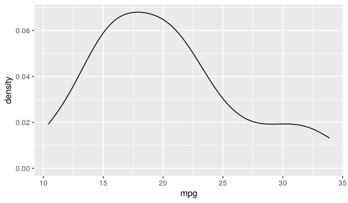<!-- -->

Most cars do between 15 and 25 miles per gallon.

## 2. One category: bar and col

``` r
ggplot(mtcars, aes(x = factor(cyl))) + geom_bar()       # R counts for me
```

<!-- -->

``` r
cars_cyl <- mtcars %>% count(cyl)                       # I count with dplyr
ggplot(cars_cyl, aes(x = factor(cyl), y = n)) + geom_col()
```

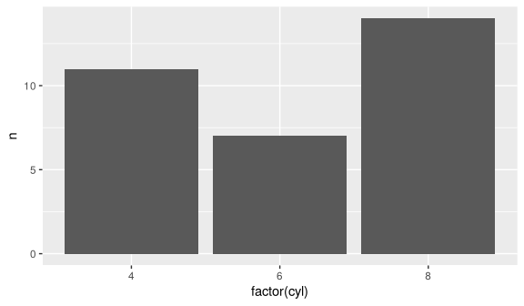<!-- -->

Cars with 8 cylinders are the most common.

## 3. Two number variables: point and smooth

``` r
ggplot(mtcars, aes(x = wt, y = mpg)) +
  geom_point() +
  geom_smooth(method = "lm")
```

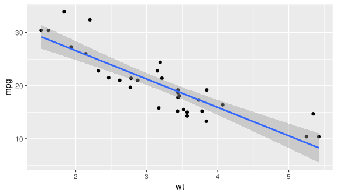<!-- -->

Heavier cars use more fuel.

## 4. Number by category: boxplot, violin and errorbar

``` r
ggplot(iris, aes(x = Species, y = Petal.Length)) + geom_boxplot()
```

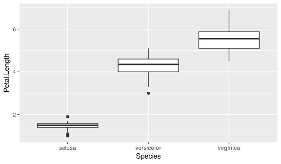<!-- -->

``` r
ggplot(iris, aes(x = Species, y = Petal.Length)) + geom_violin()
```

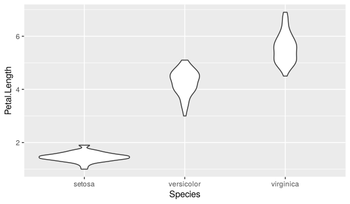<!-- -->

``` r
petal <- iris %>%
  group_by(Species) %>%
  summarize(mean = mean(Petal.Length), sd = sd(Petal.Length))

ggplot(petal, aes(x = Species, y = mean)) +
  geom_col() +
  geom_errorbar(aes(ymin = mean - sd, ymax = mean + sd), width = 0.2)
```

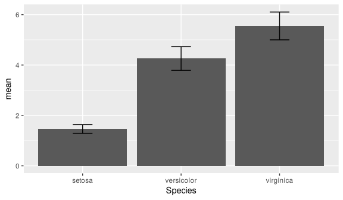<!-- -->

Setosa has the shortest petals, virginica the longest.

## 5. Time: line and area

``` r
ggplot(economics, aes(x = date, y = unemploy)) + geom_line()
```

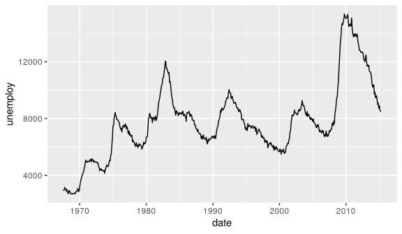<!-- -->

``` r
ggplot(economics, aes(x = date, y = unemploy)) + geom_area()
```

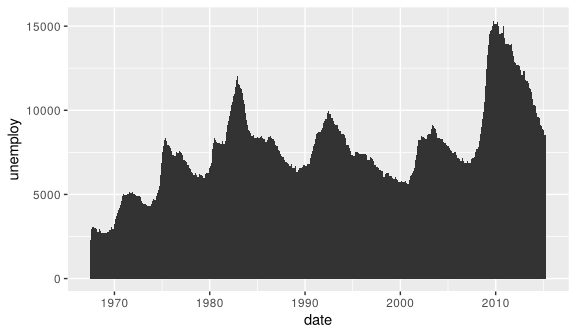<!-- -->

Unemployment in the USA goes up and down, with a big peak around 2010.

## 6. Two categories: tile

``` r
cut_color <- diamonds %>% count(cut, color)
ggplot(cut_color, aes(x = cut, y = color, fill = n)) + geom_tile()
```

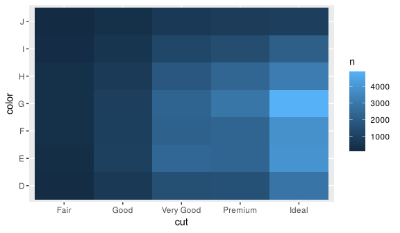<!-- -->

The lighter the square, the more diamonds. Most are “Ideal” cut.

## 7. Reference lines: hline and vline

``` r
ggplot(mtcars, aes(x = wt, y = mpg)) +
  geom_point() +
  geom_hline(yintercept = mean(mtcars$mpg), linetype = "dashed") +
  geom_vline(xintercept = 3, colour = "red")
```

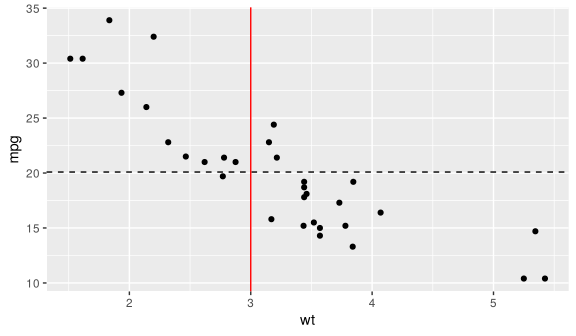<!-- -->

The dashed line is the average mpg (20.1).

## 8. Everything together

``` r
ggplot(mtcars, aes(x = wt, y = mpg)) +
  geom_point() +
  geom_smooth(method = "lm") +
  facet_wrap(~ cyl) +
  labs(title = "Weight and fuel use by number of cylinders",
       x = "Weight (1000 lbs)", y = "Miles per gallon")
```

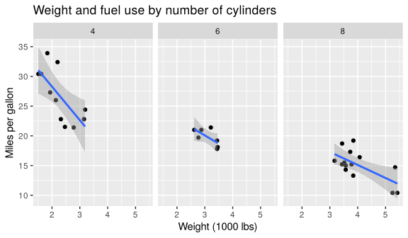<!-- -->

## Summary

| Data               | Geom                      |
|--------------------|---------------------------|
| One number         | histogram, density        |
| One category       | bar, col                  |
| Two numbers        | point, smooth             |
| Number by category | boxplot, violin, errorbar |
| Time               | line, area                |
| Two categories     | tile                      |
| Reference          | hline, vline              |
