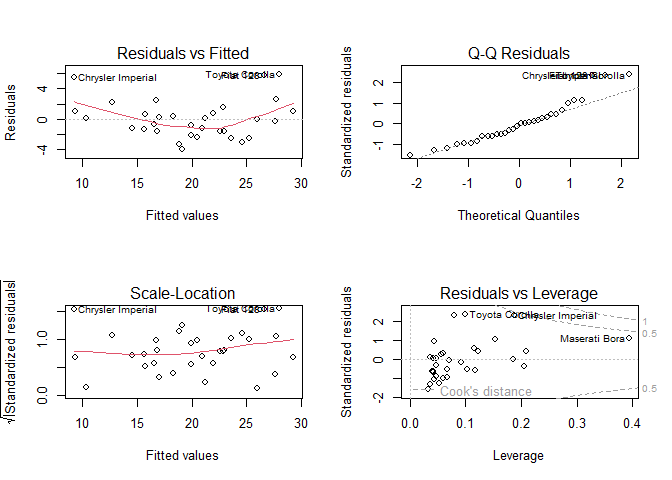

Multiple Linear Regression HW
================
Aime Fidele Iradukunda & REG: 20252MBI010
2026-11-09

# Introduction

In this homework-4, I use the built-in `mtcars` dataset to fit a
multiple linear regression model. I want to see how a car’s weight
(`wt`) and horsepower (`hp`) affect its miles per gallon (`mpg`).

``` r
# 1. Load the built-in dataset
data(mtcars)

# 2. Fit the model: Predict mpg using wt and hp
model <- lm(mpg ~ wt + hp, data = mtcars)

# 3. Display the results
summary(model)
```

    ## 
    ## Call:
    ## lm(formula = mpg ~ wt + hp, data = mtcars)
    ## 
    ## Residuals:
    ##    Min     1Q Median     3Q    Max 
    ## -3.941 -1.600 -0.182  1.050  5.854 
    ## 
    ## Coefficients:
    ##             Estimate Std. Error t value Pr(>|t|)    
    ## (Intercept) 37.22727    1.59879  23.285  < 2e-16 ***
    ## wt          -3.87783    0.63273  -6.129 1.12e-06 ***
    ## hp          -0.03177    0.00903  -3.519  0.00145 ** 
    ## ---
    ## Signif. codes:  0 '***' 0.001 '**' 0.01 '*' 0.05 '.' 0.1 ' ' 1
    ## 
    ## Residual standard error: 2.593 on 29 degrees of freedom
    ## Multiple R-squared:  0.8268, Adjusted R-squared:  0.8148 
    ## F-statistic: 69.21 on 2 and 29 DF,  p-value: 9.109e-12

``` r
par(mfrow = c(2, 2))
plot(model)
```

<!-- -->

``` r
par(mfrow = c(1, 1))
```

# Interpretation of Results

After running the multiple linear regression model, here is what the
results show:

- **Weight (`wt`)**: The coefficient is -3.87. This means that for every
  1,000 lb increase in a car’s weight, its miles per gallon (mpg)
  decreases by 3.87, holding weight constant.
- **Horsepower (`hp`)**: The coefficient is -0.03. This means that for
  every 1 unit increase in horsepower, mpg decreases by 0.03, assuming
  weight stays the same.
- **Significance**: Weight has a p-value of 1.12e-06, and horsepower has
  a p-value of 0.00145. Both are less than 0.05.This means both weight
  and horsepower are statistically significant predictors of gas
  mileage.
- **Model Fit**: The Adjusted R-squared is 0.8148. This means our model
  explains about 81.5% of the variation in gas mileage.
